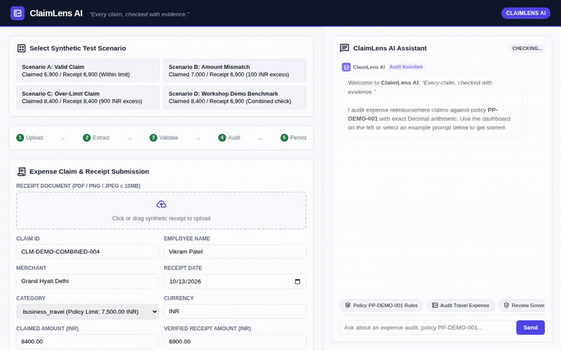

# ClaimLens AI

> **Every claim, checked with evidence.**

An enterprise expense audit assistant built on Google's Agent Development Kit (ADK) and Gemini 3.8 Flash. ClaimLens AI automates the audit of employee expense reimbursement claims against corporate policies, enforces strict deterministic arithmetic, checks receipts for discrepancies, persists audit findings to Google Cloud Firestore, and surfaces rich audit reports via dynamic A2UI cards.



---

## What ClaimLens AI Does

ClaimLens AI assists finance teams and audit reviewers by evaluating submitted expense claims against synthetic corporate travel and expense policies (e.g., `PP-DEMO-001`). Rather than delegating sensitive numerical checks or approval authority to generative models, ClaimLens AI enforces strict governance boundaries:

1. **Deterministic Policy Compliance**: Compares claimed amounts against category expense caps (e.g., 7,500.00 INR for business travel) and flags receipt mismatches using exact Python `Decimal` arithmetic.
2. **Receipt Verification**: Verifies merchant details, dates, and amounts against submitted receipts, detecting discrepancies without fabricating data.
3. **Duplicate Submission Detection**: Inspects existing claim records to flag potential duplicate filings submitted by the same employee for identical dates and merchants.
4. **Persistent Audit Storage**: Automatically records verified audit evaluations and policy findings into Google Cloud Firestore (`expense_audits` collection).
5. **Interactive A2UI Evidence Cards**: Renders structured audit summaries directly in the chat UI via Agent-to-User Interface (A2UI v0.8) cards.
6. **Strict Human-in-the-Loop Governance**: Every evaluated claim is stamped with `review_status: pending_human_review`. The agent strictly does **not** approve or reject claims, ensuring final financial authority remains with human reviewers.

---

## System Architecture & Wired Services

Based on the codebase implementation (`app/`, `frontend/`, and `agents-cli-manifest.yaml`), the following Google Cloud and ADK services are wired and active:

### Implemented & Wired
- **Gemini 3.8 Flash (`gemini-3.8-flash`)**: Core LLM configured via `google.adk.models.Gemini` for natural language policy comprehension, conversational clarification, and tool orchestration.
- **Google Agent Development Kit (ADK)**: Python ADK framework (`google.adk`) defining the conversational agent runtime, prompt contracts, tool definitions, session handling, and post-model callbacks.
- **Google Cloud Firestore (`google.cloud.firestore`)**: Database integration in `app/storage.py` that persists audited reimbursement claims in the `expense_audits` collection (with in-memory fallback during offline testing).
- **A2UI (Agent-to-User Interface v0.8)**: Generates structured, responsive UI cards (`Card`, `Column`, `Row`, `Text`) through `a2ui_callback` in `app/a2ui_utils.py` and renders them in the custom web interface.
- **Google Cloud Storage (`google.cloud.storage`)**: Receipt storage helper in `app/gcs_storage.py` for uploading and managing receipt documents and images.
- **A2A Protocol (Agent-to-Agent v1.0)**: Production transport via `a2a-sdk` bridging the FastAPI web proxy to deployed Reasoning Engine instances on Google Cloud.

### Planned, Not Yet Implemented
- **Vertex AI Memory Bank**: Cross-session long-term memory for reviewer preferences is planned as an architectural extension, but is not currently registered in the active agent tools.
- **Vertex AI RAG Engine**: Retrieval Augmented Generation across unstructured policy manuals is planned; currently, corporate policy rules are loaded and deterministically evaluated via `app/audit.py`.
- **Image Generation (Imagen)**: Document synthesis and receipt image generation are not wired into the live agent tools.

---

## Agent Tools (`root_agent.tools`)

The following tools are registered directly on the ADK agent in `app/agent.py`:

| Tool | Source File | Description |
| :--- | :--- | :--- |
| `audit_expense` | `app/audit.py` | Deterministically validates a claim against policy `PP-DEMO-001` using exact `Decimal` arithmetic. Checks category caps, receipt matches, currency conversions, and duplicate filings. |
| `save_audit_record` | `app/storage.py` | Saves verified audit results and compliance findings into Google Cloud Firestore (`expense_audits` collection). |
| `get_audit_record` | `app/storage.py` | Retrieves an existing audit record by unique `claim_id` for compliance review. |
| `list_latest_audits` | `app/storage.py` | Queries and returns the most recently audited claims from persistent storage. |

---

## Integrity & Safety Guardrails

- **Financial Exactness**: All calculations (claimed amount minus receipt amount, category limit subtractions) are computed in Python code, never by LLM arithmetic.
- **Zero Hallucination of Evidence**: The agent will not invent receipt amounts, dates, or merchants; if required fields are missing, it asks for clarification.
- **Neutral, Objective Reporting**: The agent avoids accusatory language, flagging discrepancies objectively as policy deviations rather than accusing employees.
- **Prompt Injection Defense**: Employee claims, receipt OCR strings, and merchant notes are strictly treated as untrusted user data.

---

## Getting Started (Local Development)

### Prerequisites
- Python 3.12+
- `uv` package manager (or `pip`)
- Google Cloud SDK (`gcloud`) authenticated to your GCP project

### 1. Clone & Install Dependencies
```bash
git clone <your-repo-url>
cd claimlens-ai
uv sync
```

### 2. Configure Environment Variables
Set your Google Cloud project and credentials:
```bash
export GOOGLE_CLOUD_PROJECT="your-gcp-project-id"
export GOOGLE_CLOUD_LOCATION="global"
```

### 3. Run the Application Locally

#### Option A: Run the Custom Web Frontend (FastAPI + A2UI)
Start the local web server:
```bash
uv run python -m frontend.main
```
The server will start listening on port 8000. Open your browser to the local address to interact with the ClaimLens AI dashboard, clickable example prompts, and A2UI card renderer.

#### Option B: Run via ADK Playground
To test the agent directly in the ADK developer UI:
```bash
agents-cli playground
```

### 4. Running the Automated Test Suite
Run unit tests verifying policy rules, deterministic Decimal arithmetic, storage operations, and duplicate detection:
```bash
uv run pytest
```

---

## Repository Structure

```
├── app/
│   ├── agent.py              # Root ADK agent configuration & tool wiring
│   ├── audit.py              # Deterministic audit engine (Decimal calculations)
│   ├── storage.py            # Firestore integration for expense_audits
│   ├── a2ui_utils.py         # A2UI v0.8 callback and schema generator
│   ├── gcs_storage.py        # Cloud Storage receipt upload utilities
│   ├── duplicate_detection.py# Duplicate submission detection heuristics
│   ├── extraction.py         # Receipt extraction structures
│   ├── policy.py             # Corporate policy specifications
│   └── seed_data.py          # Synthetic demo data seed script
├── frontend/
│   ├── main.py               # FastAPI proxy with A2A protocol support
│   └── static/
│       └── index.html        # Rebranded dashboard, dialogue layout & A2UI renderer
├── tests/
│   ├── test_audit.py         # Unit tests for policy limits & arithmetic
│   ├── test_storage.py       # Storage & Firestore fallback tests
│   └── test_api.py           # Frontend chat API endpoint tests
├── agents-cli-manifest.yaml  # Deployment manifest
├── pyproject.toml            # Project dependencies & tool configurations
└── claimlens_demo.gif        # Optimized walkthrough recording
```
